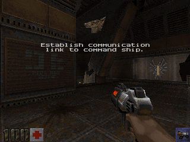
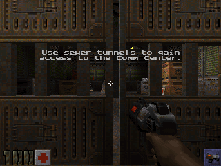

# Firebird Quake 2

 

Quake 2, simulated and rendered inside the [Firebird](https://firebirdsql.org) SQL database, running
entirely in your browser on Firebird 6 compiled to WebAssembly. The sequel to
[Firebird Quake](https://github.com/mariuz/firebird-quake), which grew out of
[Firebird DOOM](https://github.com/mariuz/firebird-doom); the next in the series is
[Firebird Quake III Arena](https://github.com/mariuz/firebird-quake3) ([play it](https://mariuz.github.io/firebird-quake3/)),
with Bézier patches, MD3 player models and deathmatch bots that think in SQL.

Every game tic is a PSQL procedure call. Every frame is a `SELECT`. JavaScript handles the keyboard,
the mouse and the canvas; everything else — collision against the BSP's brushes, the player's physics,
doors, platforms, rotating doors and fans, triggers and targets, items, the ten weapons, damage, the
monster AI, and the visibility and projection of every polygon on screen — happens in SQL.

```
keyboard/mouse → SELECT * FROM q2_tic(...)        game logic: 20 Hz, PSQL
               → SELECT * FROM frame_all(...)      the frame, in one result set: the visible polygons
                                                   (or every vertex projected, with texel coordinates),
                                                   the MD2 models and sprites in the PVS with their pose,
                                                   this frame's light animation, what to play and where
               → JS rasterises polygons and models through colormap.pcx → canvas
```

The tics are the wall clock's, 20 a second; the page paints at the display's rate, each frame the last
tic's moved toward the current one by the fraction of the tic gone by, and each model's pose blended from
the frame it left over the tenth of a second the step took, as Quake 2's client drew the server's frames
(`src/lerp.js`).

## Running it

```bash
npm install
npm run fetch-pak      # downloads the Quake 2 demo (q2-314-demo-x86.exe) and extracts baseq2/pak0.pak
npm test               # SQL smoke test in Node against the real Firebird WASM engine: the Outer Base
npm run test:base2     # the same on the Installation (demo2)
npm run test:base3     # and on demo3
npm run test:monsters  # every monster, the demo's and the full game's: spawned, it sees the player, attacks, and dies
npm run test:save      # save, play on, load: the game comes back exactly and keeps running
# in the page: ` opens the console (god, noclip, notarget, give …, use …, drop …, kill, map …, fov …, skill 0-3, save, load, record …, stop, demos, deldemo …, timedemo …, screenshot, say …, bind k +attack, bind t "say hello", unbind k, unbindall, bindlist, the cvars name, hand, sensitivity, cl_run, m_pitch, crosshair, s_volume, cd_volume, cvarlist, writeconfig, exec, exec autoexec, unautoexec, timescale 0.5, players, kick 2, connect K9H2, disconnect, reconnect); T chats (say); F1 the help computer
npm run serve          # http://localhost:8080/ (as Pages serves it); add -- --coi for the threaded engine
npm run screenshots    # headless frames to docs/ (node scripts/screenshot.mjs demo1 --at=x,y,z,yaw)
npm run bench          # where a tic and a frame spend their time
npm run bench:tic      # the cost of a tic over 200 tics of play (median, p90); add --walk for a moving player
npm run bench:calls    # how many traces, leaf lookups and links a tic makes
npm run bench:ab -- <dir>  # A/B the SQL against another copy of sql/, tics alternating between two databases (--frame [--turn] for the frame)
npm run bench:raster   # where the painter spends its time (add --cold to rebuild every surface each frame)
npm run perf           # the guard CI runs: the load, the tics, the frame query and the raster held against docs/perf-baseline.json
npm run inspect        # what is in the pak (maps, models and their frame runs, sounds)
node scripts/icon.mjs  # the manifest's icons (public/icon-192.png, icon-512.png) from the pak's console font
```

Two to four can play: the Players select (or the game menu's players spin) starts a coop game, the screen
split in two views or in quarters, the keyboard and mouse the first player's and a gamepad each the others',
as `p_client.c` had coop (the demo pak has no player model, so the other players are unseen until a
registered pak supplies it; 640×480 gives four views of 320×240, and in a narrower view the status bar's
parts stack in rows from the bottom so none leaves it, and the help computer, the inventory and the score
board lay their text out to the view's width over their panel scaled to it).
Or against each other: the select's deathmatch choices play the maps as deathmatch had them, their
deathmatch-only weapons and spots in and the monsters out, items that come back after they are taken, frags on
the status bar and the score board on F1 (`dmflags`, `fraglimit` and `timelimit` at the console).
Or two to four pages, over the network: one hosts (Host makes an offer, a short text to send to the other
player), the other joins (Join takes it and makes an answer to send back), and the host's game runs with the
guest's player in it (coop, or a deathmatch when the host's Players select says so: the frags on every page's
status bar and score board), each page painting its own view, the guest's from the frames the host sends it over a
WebRTC data channel, its own move predicted ahead of them as the Quake 2 client predicted (the player's move and
the traces have a JS twin, `src/pmove.js`, held to the SQL's numbers). Host again while hosting makes an offer
for the next player, who joins the game as it runs, a channel each; a joined page that ticks "spectate" only
watches, with no body in the game; `say <text>` at any page's console (`T` opens it with `say ` typed) puts the
words on every player's message line by the speaker's name, and a joined page's game commands (`god`, `give`,
`kill`…) run at the host for its player; `players` at the host's console lists the clients and what drives
each, `kick <n>` drops a guest; the host's menu and `P` do not stop a shared game, as Quake 2
paused single player alone. There is no signalling server on a static site, so the texts go by hand,
or through a relay of your own: `npm run signal` runs one (`scripts/signal.mjs`, a small HTTP server with
four-letter room codes), `rtc_signal http://host:8787` at the console of both pages points them at it, and
Host then shows a code for the other player to type after Join, or to give `connect <code>` at the console
(`disconnect` leaves, `reconnect` joins the last host again: Host again keeps the host's code) (the page on Pages is https, which reaches
an http relay only at `localhost`: anywhere else the relay goes behind https, a reverse proxy's). Two players whose networks a STUN server
cannot cross (symmetric NATs) give both pages a TURN relay with `rtc_ice turn:host:3478 user pass` at the
console, kept in the settings.

The page opens as Quake 2 did, on the attract loop: the recording the pak ships plays with the main menu
over it (Escape puts the menu away, a key brings it back), and a new game starts from the menu, the Map
select or the console; a game's end and the menu's quit go back to it. The Demo select (or `demomap
q2demo1` at the console) plays a recording too: the view and the entities are the recording's, read from
the server's messages as the client read them, and the walls are the database's, asked for that view each
frame; at its end the pak's next plays (`timedemo q2demo1` plays it as fast as the page paints and reports
the frames a second, `screenshot` downloads the view as `quake00.png`). `record <name>` at the console writes the game from then on as a
demo of its own, the frames' rows as the server's messages; `stop` (or the level's end) downloads it as
`<name>.dm2`, which the Demo select plays here and Quake 2 plays itself, with the same pak (a joined page
records the frames the host sends it the same way); the recordings
are kept across reloads (`demos` lists them, `deldemo <name>` drops one), and a `.dm2` of your own opens from
the file button beside the select. A level exit
that names a cinematic plays it from the pak's `video/` (the demo pak has none; the full game's intro and
unit transitions play as `cl_cin.c` played them).

Escape brings up Quake 2's menus over the game: a new game, the save slots, the credits, the options with
`customize controls` (the keys menu: Enter then a key, a mouse button or a wheel notch rebinds an action, Backspace clears it; `writeconfig` and the
Config control write the binds and the cvars as Quake's `config.cfg`, which `exec` or the control runs back in another browser, and a config
picked with the control's autoexec box ticked is kept in the browser and runs at every start, as `autoexec.cfg` did; the binds are
kept with the settings in this browser; a key bound at the console to any other line, `bind k god`, `bind t "say hello"`, runs it as it goes down), the multiplayer menu's `join network server` and `start network
server` (the page's Join and Host) and its `player setup` (your name, for the
obituaries and the score board, and your handedness: a left-hander's shots come from the left and the gun is
drawn mirrored, a centre-hander's from the middle with no gun drawn, as `P_ProjectSource` and the renderers
had them; a guest's go to the host), the video modes, quit.

`fetch-pak` needs 7-Zip or `unzip` to open the demo's self-extracting archive. If you own Quake 2, point
the page at your own `pak0.pak` with the file picker, or copy it with `PAK=/path/to/pak0.pak npm run fetch-pak`:
the base unit's maps and monsters work the same way.

The page needs no special headers. Served as GitHub Pages serves it, without COOP/COEP, it runs
`firebird-wasm`'s build without threads (since 0.8.0), which needs no `SharedArrayBuffer`; served
with the headers (`npm run serve -- --coi`) it runs the threaded build. Both play the same: on
demo1 a tic takes 5 ms either way, and the build without threads starts sooner (the first
frames in 5.6 s against 6.5 s here). The service worker that used to supply the headers is
retired: what is left at its URL removes itself from the browsers that still have it.

The page installs as an app (a web app manifest, `public/manifest.webmanifest`, with icons drawn from the
pak's console font by `scripts/icon.mjs`) and runs without a network once it has run once: a caching
service worker (`public/sw.js`) serves the build's files and the pak from the caches the page fills after
its first load (the "offline ready" pill says when), each build in its own cache and the pak in one that
outlives them. A pak picked from the PAK control is kept in the browser (IndexedDB, as the recordings are)
and loads at the next start in the demo's place, until the button beside the control forgets it; a picked
music folder's tracks are kept as they play. The browser test reloads the page offline and plays, the picked
pak and track found again.

## How it works

The long version is [docs/ARCHITECTURE.md](docs/ARCHITECTURE.md): every table, procedure and pass, the
frame protocol, the painter, and the measurements behind the design. [docs/ROADMAP.md](docs/ROADMAP.md)
lists what is next, from coop over the network to deathmatch, and what waits on the registered pak. [CLAUDE.md](CLAUDE.md) is the
working memory for whoever (or whatever) works on this next: commands, how to measure, the engine's
rules learned the hard way.


### The BSP becomes tables (`sql/schema.sql`, `src/loader.js`)

A Quake 2 BSP (IBSP version 38) is a relational database in disguise, and more so than Quake's:
`loader.js` parses it (`src/bsp.js`) and copies it in, denormalised so the hot loops never need a
second lookup:

| table | from |
|---|---|
| `faces` | FACES + PLANES (flipped for `side`) + TEXINFO (the .wal name, the SURF_* flags), plus a bounding sphere |
| `face_verts` | EDGES and SURFEDGES resolved to an ordered vertex list per face |
| `nodes` | NODES with their plane copied in (children < 0 are leaves) |
| `leaves` | LEAVES with their cluster and area, and the cluster's PVS decompressed to a hex string |
| `leaffaces`, `leafbrushes` | the leaf → face and leaf → brush index arrays |
| `brushes`, `brushsides` | the collision volumes: contents, and each side's plane and surface flags |
| `models`, `anims` | the world, its submodels (`*N`), every `.md2` with its frame runs, the `.sp2` sprites |
| `map_ents` | the entity lump |

Each table goes in as one `INSERT` run for every row by firebird-wasm's `execBatch`: one `IBatch`
request to the engine for thousands of rows, the numbers bound in binary. The Outer Base (90 k rows)
loads in about two and a half seconds in Node, and the page skips the 37 k face vertices that only
its SQL-projecting renderer mode reads, loading them on demand: about two seconds. (It used to be generated `LOAD_<table>` procedures parsing 30 KB
chunks of fixed-width rows in PSQL, which beat 0.4.0's batch, a statement execute per row, by 13 %;
0.4.1's `IBatch` beats them by 15 %.)

### Collision is a recursive procedure (`sql/physics.sql`)

Quake 2 ships no clipnodes: a trace walks the node tree with the moving box's extents pushing each
split plane out (`CM_RecursiveHullCheck`) and, in every leaf it reaches, clips the segment against the
leaf's brushes whose contents match the mask (`CM_ClipBoxToBrush`). `RHC` is that walk as a recursive
PSQL procedure threading the trace state — fraction, hit plane, surface flags, contents, `allsolid`,
`startsolid` — through its parameters; `CLIP_LEAF` is the brush clipping. `TRACE_MOVE` runs it against
the world and against every brush-model entity at its own origin (rotating doors are traced in their own
rotated space, as `CM_TransformedBoxTrace` does), and clips against monsters and the player with a
Minkowski slab test, honouring `CONTENTS_MONSTER` / `CONTENTS_DEADMONSTER` so bullets hit corpses and
players walk through them. `FLY_MOVE`, `WALK_MOVE` (the 18-unit step), `MOVE_STEP` (monsters),
`TOSS_MOVE` and `PUSH_MOVE` (doors crushing and carrying, fans turning) are g_phys.c; the clip planes
and the pushed entities live in global temporary tables because PSQL has no arrays.

### The game is PSQL (`sql/game.sql`, `sql/weapons.sql`, `sql/monsters.sql`)

`Q2_TIC` runs the player (pmove.c: ducking, friction, acceleration, jumping, swimming, drowning, lava,
and the view's bob),
the pushers (doors and their teams, rotating doors, plats, buttons, trains with path corners, rotating
fans, timers), the thinks that are due, and the physics of everything that flies, bounces or falls.
Triggers (once, multiple, relay, always, counter, key, push, hurt) and targets (speaker, explosion,
splash, secret, goal, help, laser, changelevel with its `map$spawnpoint` and the intermission at a unit's end,
the unit's cross-level flags) are
g_trigger.c and g_target.c.
Items from stimpacks to the power shield, the ammo boxes, the keys (the power cubes counted one by one, each door spending one) and the timed powerups, with the
inventory they wait in (TAB, `[` `]`, ENTER, and Q, I, B, E for the powerups), are g_items.c and g_cmds.c; the blaster, shotgun, super shotgun, machinegun, chaingun, hand grenades, grenade and rocket
launchers, hyperblaster, railgun and BFG10K are p_weapon.c and g_weapon.c; armour, knockback, radius
damage and gibs are g_combat.c. The monsters run g_ai.c's state machine — `FIND_TARGET`,
`MOVE_TO_GOAL`, `NEW_CHASE_DIR`, `CHECK_ATTACK` — with the light, shotgun and machinegun guards, the
enforcer, gunner, berserker, flyer, parasite and tank defined in `monster_types`. Everything the
simulation wants heard is a row in `sound_events`; temp entities are rows in `fx_events`.

### The renderer is a query (`sql/render.sql`)

`FRAME_ALL` finds the leaf and cluster the eye is in and, once per cluster, marks every face of every
leaf whose cluster is in its PVS and whose area a closed door does not cut off into `vis_faces` (Quake's `visframe`), with each face's plane and
bounding sphere copied in; the last sixteen clusters' sets are kept, so walking back costs nothing, and the cluster the player is heading into is marked in a frame's spare time, so most crossings cost nothing either. The frame is then a scan of that table with the back-face and frustum tests
as expressions, aggregated with `LIST()` into one row holding the visible face ids; each brush model in
the PVS (doors, plats, the fan — whether its clusters are visible is decided once per view cluster and
kept on its row) adds a row of its own faces at its origin. The same result set carries the MD2 models
and sprites in the PVS with their pose, the light styles, the new sounds and effects and the brush
models' poses, so a frame is one round trip to the engine. Two renderer modes are selectable in the
page: **SQL picks faces, JS projects** (the default) and **SQL projects every vertex** (`FRAME_FACES`:
one cursor joins the selected faces to their vertices and computes the rotation, the view transform,
the projection and the texel coordinates in the select list); both paint the same pixels
(`node scripts/screenshot.mjs demo1 --compare`). `FRAME_FACES_FAST` and `FRAME_ENTS` expose the face
and entity rows for scripts and the SQL console.

### JavaScript only paints (`src/renderer.js`)

An 8-bit framebuffer of palette indices and a z-buffer, like ref_soft. Polygons are scan-converted with
perspective-correct spans over a surface cache: the `.wal` tiled under the face's lightmap (the RGB
lightmap collapsed to its brightest channel, as `Mod_LoadLighting` did), run through `colormap.pcx`. As in
`D_DrawSpans16`, the texel coordinates are divided out every 16 pixels and stepped linearly between, the
mip level is chosen per surface as `D_MipLevelForScale` chose it (so far walls come from the smaller
images and don't shimmer), and a
surface is built the way `R_DrawSurfaceBlock8` did it: one row of light values interpolated per texel row,
stepped along it, so the painter spends about 1.5 ms on a 320×240 frame in Node and 3 ms when every surface
in view has to be rebuilt (a light style changed, a new area opened), down from 3 and 30; the 640×480 mode
costs about three times as much.
Translucent surfaces (`SURF_TRANS33/66`) are blended through the alpha map in the same picture; warping
surfaces ripple and flow, and with the eye under water the whole view wobbles as `D_WarpScreen` made it;
the sky is the `env/` cube map sampled by each pixel's direction. MD2 models
are lit as ref_soft lit them (the light under the model split into ambient and shade, the shade from a fixed
world direction by the vertex normals; items pulse, the gun never goes below a minimum), clipped
against the near plane triangle by triangle; sprites face the view; explosions are the fireball models
fading through their skins as `CL_AddExplosions` drew them; explosion debris, blood, blaster sparks
and the rail trail are particles. Muzzle flashes, rockets, blaster bolts, the BFG ball and explosions are
dynamic lights, added to the lightmaps of the faces they reach as ref_soft's `R_AddDynamicLights` did
(those faces are rebuilt for the frame) and to the models near them. The status bar comes from `pics/`.

Saved games: Escape brings up Quake 2's menus (`F2` save, `F3` load, `F10` quit), with fifteen slots and
an autosave as each map starts; `F6` quick-saves and `F9` quick-loads. A save is the four game tables (`game`, `player`, `ents`,
`lightstyles`) read out as rows and kept gzipped in the browser's `localStorage` (about 20 KB; it was
140 KB of plain JSON, and a save carrying the unit's other levels four times that); a load
reloads the map's geometry and puts the rows back, remapping model ids by name and restarting the entity
id sequence above the highest saved id (`src/savegame.js`). It takes about a fifth of a second. The Saves
controls write the game as a file (`<map>-<time>.q2sav`: a slot's text) and play one back, so a game moves
between browsers, which `localStorage` does not; `D` on a slot of the load menu writes that slot as it is
stored (`save<n>-<map>.q2sav`).

Sound: `sound_events` rows are played with the Web Audio API, attenuated and panned from where they
happened. The map's looped `target_speaker`s play at their origins and follow their on/off state in the
`ents` table; the entities' looped sounds (a bolt's or rocket's flight, a moving door, the railgun's hum)
are listed by each frame and follow the entities, and both are mixed per sound as `S_AddLoopSounds` mixed them. Quake 2's music was CD audio, not in the pak: put `track02.ogg`…`track11.ogg` (or `.mp3`)
in `public/music/`, or pick that folder in the page (its tracks are kept as they play, for the next start),
and each map plays its `worldspawn` track; without them a synthesised drone fills in.

## Firebird lessons

The ones from Firebird Quake still hold (join the marked set rather than `IN (subquery)`; arithmetic in
the select list is cheap, PSQL statements are not; rows are the cost; keep what does not change; bind as
text, which since firebird-wasm 0.4.0 means in binary for a number). New here:

- **Brush collision is more work than clipnodes, and most of the work is visiting leaves.** A player-sized
  box straddles many split planes, so the walk reaches dozens of leaves, nearly all of them empty. The
  `nodes` rows carry each leaf child's contents, so an empty leaf is skipped without a call, and the walk
  descends iteratively while the segment stays on one side, recursing only at a split. Each procedure
  call costs about 18 µs with 36 parameters, so calls are what to count.
- **Clip the whole segment in every leaf.** `CM_TraceToLeaf` clips the full trace, not the piece of it
  inside the leaf; clipping sub-segments made fractions incomparable and produced phantom hits at the start.
- **Arithmetic belongs in the select list; PSQL runs once per brush side.** The side's distances to both
  endpoints are expressions of the cursor, the loop only branches. An attempt to go further, one aggregate
  row per brush (`MAX`/`MIN` over the sides' enter and leave fractions from a grid of brushes), was
  slower: derived tables are inlined, so every reference to `d1` and `d2` re-evaluated the dot products.
- **Linking is the hidden cost of a move.** Every step relinks the entity to find its clusters for the
  PVS test; an entity that did not move is not relinked, and three point lookups serve instead of ten.
- **Idle rows should cost nothing.** Pushers that are not moving and have no think pending are skipped
  entirely; patrolling monsters out of the player's PVS think at 3 Hz and stride three times as far.
- **A frame whose view holds still is the last frame.** The world's visible-face list is kept on `viewcfg`
  with the eye position and view axes it was made for and reused while they hold, and so is the eye's leaf
  while only the view turns. The frustum tests themselves lost a third of their arithmetic: (c − e)·f is
  c·f − e·f, and e·f is a constant of the frame, not of the row. The entity row carries its model's kind
  and radius so the frame never joins `models`; the light-style list names only the styles that animate
  or that the map switches, the page holds the resting values. A brush model is tested against the frustum
  as a whole before its faces are, and its face list is kept on its row while the view holds and it does
  not move. An entity's clusters are three integer columns rather than a string, so the alias entities'
  PVS test is an expression of the cursor on the eye's leaf row, like the frustum tests: only the
  entities drawn reach PSQL at all. The frustum is four world-space planes, each a one-sided test that
  fails at the first plane a sphere is outside, instead of two `ABS` tests that each recomputed the depth;
  and a face whose plane has the eye's whole cluster behind it is left out when the cluster is marked,
  since no eye in the cluster can ever face it. Frame query, view held: 6.3 → 1.6 ms; turning: 3.5 → 1.9 ms.
  What is left of a turning frame is the scan of the cluster's front-facing faces, about 1.3 ms, which
  is the expression evaluator's floor: a leaf-level cull first would cost more in row fetches than it
  saves, in this engine.
- **Count the calls before timing the bodies.** A tic was making 43 tree descents, three per leaf
  lookup: a function in a `WHERE` clause (`WHERE l.id = point_leaf(…)`) is evaluated three times, for the
  index probe, the predicate and the fetch. Assigning it to a variable first made it one. And six
  exploding barrels and a dozen standing monsters were falling every tic: placed exactly on the floor,
  their first trace started in solid and never set the ground flag. Starting the drop a unit up, as
  `M_droptofloor` does, and treating a thing that cannot move at all as standing, removed 17 ms a tic.
- **An `UPDATE` of the wide `ents` row costs about 85 µs, as much as a trace step.** A monster's think
  wrote its next think time in one statement and its frame in another; now the think time rides along
  with whatever the think writes anyway. A step that stays in the same leaf keeps its cluster list
  instead of probing the box's corners again, and the step's position write carries the link position
  so the relink writes nothing. The player's water check runs only after a move, and writes the row
  only when the level changed; a map without water skips it altogether.
- **A function nested in a condition's expression runs twice.** `IF (f(x) = 1)` calls `f` once;
  `IF (BIN_AND(f(x), 56) <> 0)` calls it twice. The water check of every monster step walked the tree
  twice for that reason. Timing a procedure does not show this; counting its calls does.
- **The player's tic writes its two rows once.** Pitch, the jump latch, the view's step smoothing and the
  air timer used to be five writes of the player row and the yaw, the velocity and the ground flag three
  of the entity row, every tic, standing still or not; they are one write each now, and a player standing
  on the ground with no velocity does not move at all (the floor under them is re-checked twice a second
  rather than, as pmove does, every frame).
- **What nobody sees can think slowly.** A standing monster out of the player's PVS cannot see the player
  either, so it thinks at 3 Hz like a patrolling one does; a patrol out of sight strides four times as far
  at 2.5 Hz, with `SV_CloseEnough`'s stride-sized corner check so it does not overshoot its path corners;
  in sight everything is back to Quake's 10 Hz. A think also turns and aims in one write of the row (the
  wished yaw travels as a parameter instead of being written and read back) and tests the PVS on the leaf
  row itself rather than copying the 2 KB string into a variable first. Moving the tree walk's arithmetic into the node fetch's select list, on the
  other hand, changed nothing measurable: the fetch itself is the cost of a level, not the statements.
- **A row out of a procedure costs about 6 µs; a `LIST()` costs about 1 µs per element.** The frame used to
  be six queries returning some 600 rows (one per visible face), each row fetched through the WASM
  boundary; in the browser each query is a round trip to the engine's worker as well. Now the visible
  face ids travel as one ',' separated list per model, and faces, entities, light styles, sounds and
  effects come back from a single procedure as rows tagged with their kind. The marked faces carry their
  plane and sphere, so the scan needs no join, and whether a door's clusters are in the PVS is decided once
  per view cluster rather than parsed from strings every frame.

With all that, an idle tic on the Outer Base at hard skill (31 monsters, 14 of them patrolling) costs
about 3 ms in Node (about 5.5 with the player walking), down from 40 at first and 20 after the first round;
the frame's query 1.9 ms turning and 1.6 ms with the view held, down from about 18 for the six queries it began as.

## Licence

MIT for the code here. Firebird and Electric Firebird are Apache-2.0. The Quake 2 demo is freely
redistributable; Quake 2 is a trademark of id Software.
